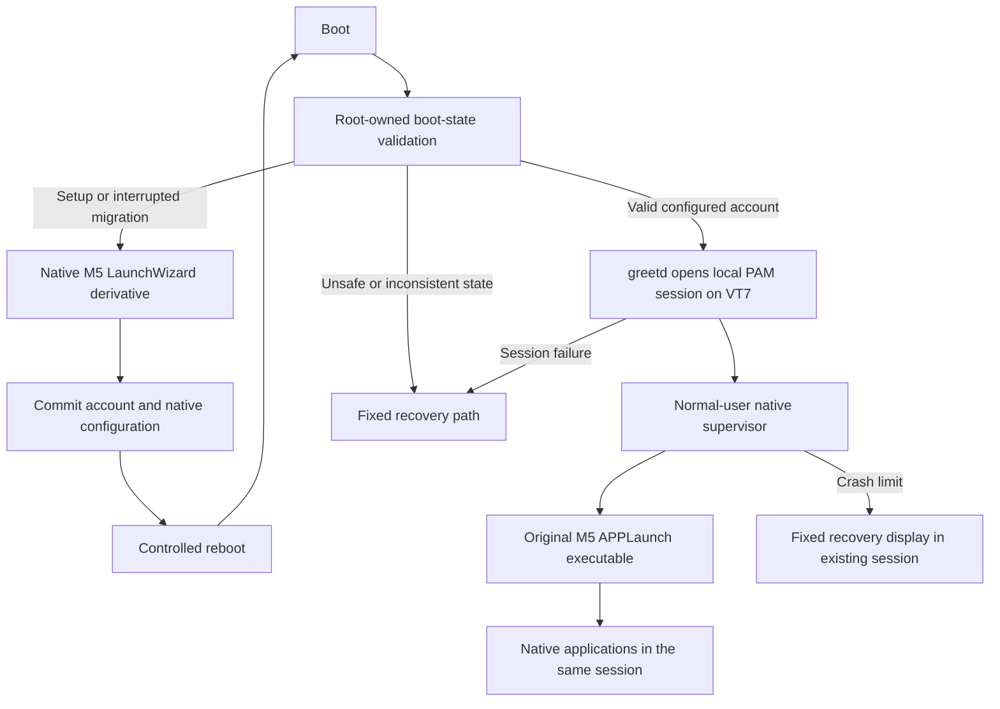

# Tyrell Zero implementation plan

Plan revision 3: November 15, 2026. Five fresh agents challenged the battery
strategy after revision 2's three-agent review, building on the original
five-agent plan and nine-agent [live power investigation](cardputer-zero-power-audit.md). It specifies a
lighter **Debian Trixie ARM64 base system for CardputerZero,
retaining M5 APPLaunch and all native hardware**. Application power optimization
is excluded.

Implementation now includes inactive foundation packages, strict profile/contracts,
the real native Wizard derivative and guarded AppStore integration built/tested
in the ARM64 builder. See [implementation progress](tyrell-zero-progress.md)
for what exists and its evidence. The stage0–2 pipeline, offline activation and
independent verifier now have an [implemented workflow](tyrell-zero-pipeline.md).
Full image construction and hardware/battery qualification remain separate;
this document describes the complete target behavior.

This is an implementation plan, not an implemented build profile. Commands and
new interfaces marked **proposed** remain future work unless the progress record
identifies an implemented component. The planning revisions changed only
documents and research records. The preceding live research temporarily
changed device policies and restored them; it did not build or qualify Zero.

Build a hardware-complete native control first. Then qualify the two demonstrated
policy candidates—Ethernet USB autosuspend and a shorter ondemand boost hold—
independently and together. Promote only policies that preserve functionality
and responsiveness and demonstrate a benefit while battery-powered. USB input
measurements screen candidates; they cannot alone select the battery-saving
default. The fallback is the
lighter native image with its original power policy. It claims no additional
tuning benefit; a whole-image battery claim requires its own comparison against
the matched full-source control.

## Decisions

| Area | Selected design |
| --- | --- |
| Product/profile | Tyrell Zero; new `tyrell-zero` source-build profile with its own work, locks and artifacts |
| Base | Debian 13/Trixie, ARM64, vendor pi-gen stages0–2; omit stage3/4 desktop roots |
| M5 interface | Retain the complete pinned APPLaunch 0.6.105 package and original M5 launcher executable |
| Native login | Debian greetd, PAM/logind, and a supervised direct launcher process inside the local session; no desktop server/compositor |
| First boot | Image-owned native LaunchWizard derivative in a separate package; replace the desktop-specific setup/handoff only |
| Hardware | Preserve current kernel/BSP, full firmware/module/overlay trees and every native capability |
| Networking | NetworkManager/WPA, Bluetooth and SSH support, with explicit first-boot provisioning; retain `.local` discovery |
| Bring-up/control policy | Original ondemand factor 50, Ethernet USB leaf `on`, GPU/CMA/swap unchanged; retain effective Wi-Fi power saving and Ethernet EEE |
| Power candidates | Narrow Ethernet leaf `auto`, initially 2,000 ms delay; ondemand factor `1` first, with other tunables/limits unchanged; isolate, then combine |
| Release power policy | Select only after spare-card functionality, performance and battery-powered energy/runtime gates; capture the selected preset in immutable release inputs |
| Updates | Ordinary M5 application management retained; base components updated through a qualified, pinned base channel |
| Output | `tyrell-zero-trixie-arm64-lite.img.xz`, with manifests, checksums, package inventory, captured inputs and acceptance records |

The existing stock-derived mode and source-desktop mode remain functional and
unchanged. Stock remains the compatibility/recovery reference. A matching
full-source control is used for causal footprint and power comparisons.
The `-lite` filename suffix describes the vendor's OS stage convention, not a
reduction in supported CardputerZero hardware.

## Locked starting point

| Component | Starting identity |
| --- | --- |
| Vendor pi-gen | `5f4c44f3431bf1dfb968c10f7228ad6fa0c66cf4` |
| M5 BSP | `75518549a2640486f5d13ea72ca4935b198d7c20` |
| Kernel | `6.18.39+rpt-rpi-v8`; package `1:6.18.39-1+rpt1` |
| M5 package | `applaunch 0.6.105`; locked `.deb` SHA-256 `a38cffde9cb4d60f4ff2d6c95323c64f66cc705fdf315b0550e123ca7b5a9544` |
| M5 source identity | `e7f60859fcc8bd867f3b8c4b3acd45dfa82ca39f` |
| Original launcher executable | SHA-256 `9f26df9329160385c68794d26e0c7153271c6a69bb048938580e1495418c968c` |
| Distribution power policy | `raspberrypi-sys-mods 1:20260914`; `.deb` SHA-256 `a6169bc9506b36ba92d72c88d3390b6eefc8eb616fd9a46100f9bbf3ac088211` |
| Current source APT seed | 1,679 retained identities; lock SHA-256 `7df91bba2940d04aaa56179ab7320d08107f4dd18dcb420364dc946d9dc5ea8e` |
| New login dependency | Exact `greetd 0.10.3-4` ARM64 package cached/verified; complete Zero APT closure still required before image build |

The retained APT repository matches the checked-in seed lock. It does **not**
contain greetd. A separately verified candidate package is now cached, but is
not yet in the final Zero APT closure. The seed is a source of verified bytes,
not the final Zero package selection. All new source/build dependencies, recursive source
dependencies and assets for the native Wizard require explicit locks.

greetd's ARM64 package is approximately 1.24 MiB installed and does not require
an X/Wayland server. It can execute a native session directly.
[Trixie package](https://packages.debian.org/trixie/arm64/greetd),
[versioned worker](https://sources.debian.org/src/greetd/0.10.3-4/greetd/src/session/worker.rs/).

## Native boot and M5 integration

The detailed contract is in [native-session design](tyrell-zero-native-session.md).
The selected architecture is:



The exact `.105` Wizard makes desktop autologin (`raspi-config ... B4`) a
mandatory step before enabling APPLaunch. Its preprovisioned shortcut also
hands off to the legacy user unit. Both routes must converge on native setup;
changing only `graphical.target` is insufficient.
[Exact Wizard source](https://github.com/CardputerZero/launcher/blob/e7f60859fcc8bd867f3b8c4b3acd45dfa82ca39f/projects/LaunchWizard/main/ui/wizard_service.cpp).

The proposed `tyrell-zero-session` package installs a narrowly patched Wizard
at `/usr/libexec/tyrell-zero/LaunchWizard`, a supervisor, recovery display,
boot-state helper and profile-owned configuration. The vendor main executable
and original bundled program bytes remain intact. The AppStore public pathname
has one declared diversion/dispatcher, as specified in the session design.
Its root Wizard unit override retains
`WorkingDirectory=/usr/share/APPLaunch` and uses the existing resource tree.
Build/resource-path compatibility is a prerequisite, not an assumption.

Only Zero masks the vendor `APPLaunch.service` user unit. The original M5
launcher runs directly beneath greetd's PAM session, not via a different user
service with an imported session ID. Preserve user audio services on the normal
runtime bus, device groups/udev rules and the active local seat needed for
ordinary removable-media authorization.

No hidden interactive shell, root application session, shared default password,
or broad Polkit authorization rule is part of the design. Recover through the
fixed native screen, authenticated SSH when provisioned, orderly reboot, or
the preserved reference card.

## Runtime and service contract

Preserve the full M5 package, hardware applications and their runtime closure
for the first candidate. Keep fonts, including CJK, initially. Dependency
selection must include ELF providers, `dlopen` backends, plugins, external
commands, service activation paths, permissions and configuration—not only
package `Depends`.

| Group | Required roots/behavior |
| --- | --- |
| Core/session | systemd/udev, D-Bus, `dbus-user-session`, `libpam-systemd`, greetd/PAM, login/account tools, Polkit, console/keymaps |
| M5 runtime | `xdg-user-dirs`, libc/libstdc++/libgcc, libinput, xkbcommon, FreeType, GLib/GIO/GObject, libcrypt, OpenSSL for bundled programs, required CLI providers |
| Network | NetworkManager, WPA backend, OpenSSH, Broadcom firmware, BlueZ/firmware, Avahi, DNS and time synchronization |
| Audio | PipeWire/Pulse compatibility, WirePlumber, RTKit, ALSA/Pulse libraries/tools, SPA/Bluetooth support and vendor routing/limits |
| Camera/sensors | Complete compatible camera/IPA/tuning/rpicam/Picamera2 stack; IMU modules and initialization firmware; RTC/IR support |
| USB/expansion | UDisks2/Polkit, host/gadget/modeswitch/media filesystem support, GPIO/I2C/SPI/UART bindings, relevant permissions and routing |
| Graphics/media | KMS/DRM, Mesa/runtime libraries, native media plugins/decoders, required fonts and existing HDMI helper prerequisites |
| Base maintenance | APT/keyrings, certificates, time, bounded journals/log rotation, existing zram/swap policy and essential diagnostics |

Omit the `rpd-*` desktop/application/developer/graphics/utility metapackage
roots, LightDM/labwc/X/Wayland servers and their unnecessary helper clients.
Audit optional PackageKit, Pi Connect, printing and NFS/RPC software against
the desired software features. Preserve needed shared libraries even when their
name contains X/Wayland; a GStreamer X plugin does not require a running desktop.

Mark protected runtime roots explicitly. After BSP installation and ABI checks,
an exact simulated transaction may remove build-only compilers/debuggers/headers.
Do not broad-autoremove, remove Python indiscriminately or prune firmware/modules.
If initial accounting already meets the footprint target, defer this pruning
until the first hardware-complete candidate passes.

The default native payload is the existing verified Tyrell Status package plus
the new session and power-policy packages. The latter initially selects the
unchanged control preset. Keep support for an explicit list of additional
verified native packages. Use the qualified Video package and vendor hardware
apps for compatibility tests; do not make uncommitted game work a base-image
dependency. Native application power behavior stays unchanged.

## Power policy informed by live evidence

The current-firmware experiments establish two repeatable diagnostic effects:

| Isolated change | Observed effect | Still unproven |
| --- | --- | --- |
| No-link Ethernet USB leaf `on` → `auto` | Leaf, hub and USB root suspended; USB interrupts about 8,000/s → zero in both trials | Electrical saving, automatic cable wake, traffic and complete USB mode compatibility |
| Ondemand `sampling_down_factor` 50 → 1 | Time at 1 GHz about 79% → 6% in both trials; CPU limits retained | Electrical saving, equal completed work, latency and audio/media qualification |

These fifteen live phases are input research on existing firmware, not completed
Zero acceptance. Do not turn the observed rates into battery-life estimates or
require zero USB interrupts when legitimate peripherals/traffic are active.

### One base image and four captured policy presets

| Initial preset | Ethernet leaf | Leaf delay | Ondemand factor | Purpose |
| --- | --- | ---: | ---: | --- |
| `baseline` | on | 2,000 ms | 50 | First boot/hardware acceptance and lightweight control |
| `ethernet` | auto | 2,000 ms | 50 | Isolate the USB policy |
| `cpu` | on | 2,000 ms | 1 | Isolate the CPU policy |
| `combined` | auto | 2,000 ms | 1 | Evaluate interactions and the intended release candidate |

Keep `ondemand`, `up_threshold=50`, `sampling_rate=100000` microseconds,
`ignore_nice_load=0`, `powersave_bias=0`, `io_is_busy=0`, and 600–1,000 MHz
limits fixed across these presets. Preserve GPU memory 128 MiB, CMA 64 MiB,
swap, Wi-Fi power saving, EEE and all native clients/settings.

Capture leaf delay, wakeup-attribute availability/value, parent policy,
active/suspended residency and transition counts, not just `control=auto`.
Retain 2,000 ms across the initial comparisons. If intermittent traffic shows
that resume churn erases the benefit, qualify only a bounded leaf-delay
comparison of 2,000 versus 5,000 ms. If CPU factor 1 fails battery-energy or
responsiveness gates, permit a predeclared comparison of factors 2 and 5 against
the same control. Do not expand into unrestricted tuning. Select by battery
benefit and performance, not minimum clock residency; freeze any selected
factor/delay in the final contract and rerun combined qualification.
[Runtime PM transition costs](https://docs.kernel.org/power/runtime_pm.html#autosuspend-or-automatically-delayed-suspends).

Use one coherent Zero package closure and frozen rootfs for initial comparisons;
capture every trial's preset/config hash and effective settings on the qualified
spare-card installation. This does not require four independent OS profiles or
complete builds. Final release images must reproducibly include their selected
preset: a changed preset changes the captured input identity and requires a new
job, not resuming or overwriting an earlier artifact.

The stock-derived image is a compatibility/recovery reference. Compare the
matching full-source desktop image against **Zero baseline** to measure the
desktop/base-stack change. Compare the other three presets against **Zero
baseline** to isolate power policy. Do not bundle both changes into a single
stock-versus-Zero comparison and attribute the result to either one.

### Proposed ownership and persistence

Add `tyrell-zero-power-policy`, separate from the session package, plus a
versioned `image/contracts/tyrell-zero-power.json` contract. Record the preset,
original/target settings, kernel/BSP/distribution package identities, matching
rules, generated configuration hashes and qualification record in captured
inputs, `/etc/tyrell-image.json`, exported manifests and resume identity.

Package installation must install files only. Maintainer scripts must not write
the builder/chroot host's `/sys`, trigger udev, run tuning helpers or apply a
policy to the live toolchain. Use event-driven configuration and bounded
oneshot work; add no periodic polling daemon.

For the CPU presets, install an inactive template under the power package's
resource directory. A bounded early eligibility helper validates board,
kernel/BSP, distribution configuration and CPU policy before exposing any
candidate override. Order it before the tmpfiles application that configures
CPU policy. Only an eligible CPU/combined preset generates
`/run/tmpfiles.d/raspberrypi-sys-mods-ondemand-governor.conf`, shadowing the
vendor file with the same basename. Preserve its other entries and change only
the factor; retain the original governor-selection udev rule. Baseline or failed
eligibility exposes no optimized override and performs no optimized write.

Prove that ordering, including missing/late sysfs policies, reboot and policy
recreation, before using a candidate. If bounded event-triggered reapplication
is needed, it must validate eligibility again before writing. Detect an
administrator override that shadows the generated configuration and mark the
candidate unqualified rather than replacing it. Do not edit vendor `/usr/lib`
files, install an unconditional factor-1 override, or add a later `zzz` file:
tmpfiles precedence is not last-write-wins.
[systemd 257 precedence](https://www.freedesktop.org/software/systemd/man/257/tmpfiles.d.html).

For Ethernet, match the integrated board/topology, USB IDs `0fe6:9900` and
bound interface driver, including re-enumeration and host/gadget changes.
Do not hardcode the observed bus number or match every adapter with those IDs.
The observed USB device driver is `r8152-cfgselector`, while its child interface
uses `r8152`; a USB-device `DRIVER=="r8152"` rule would not match this topology.
Apply `auto` only to the verified leaf and keep parent policies unchanged.
Do not administratively disable Ethernet or add a cable-polling workaround.
[udev matching](https://www.freedesktop.org/software/systemd/man/257/udev.html).

Disabling a preset must remove only its owned override/rule, restore the affected
live settings as well as future boot policy, and verify restoration after reboot.
Removing a rule alone does not restore current sysfs values. Retain the known
native-control artifact and record original settings for test rollback.
Unknown board/driver/config identities must be rejected before optimized writes,
retaining vendor configuration with a diagnostic; they must not be silently
labeled optimized or hardware-qualified. Exercise
package reinstall, supported upgrade, rollback and failed maintenance.

Also test eligibility failing **after activation**. Invalidate the candidate
generation and remove its owned generated override before future application;
a diagnostic and early return must not leave stale factor-1 configuration.
Serialize supported preset, tmpfiles/apply and base-maintenance paths, using
generation/order checks and effective-state verification. File deletion alone
cannot stop a concurrent reader that already opened it. Restore affected live
controls only when their identity remains validated; otherwise require a
controlled baseline boot. Do not certify baseline recovery until readback or
that boot proves it. These guarantees cover supported integration paths, not
arbitrary administrator writes. Coalesce duplicate events, bound reapply work
and rate-limit repeated diagnostics; include this machinery's cost in tests.

Protect the power package, helper, overrides, selected manifest and relevant
`raspberrypi-sys-mods` policy through the base-update/AppStore integration guard.
Ordinary security updates remain enabled; qualify affected base updates and
recheck effective settings rather than silently freezing security maintenance.

### Preserve hardware idle behavior and useful network defaults

After camera/video/HDMI/USB exercises and resource release, verify that physical
devices with established runtime PM return to the appropriate baseline idle
residency within a recorded deadline. Existing evidence shows IMX219, CSI,
V3D and HDMI runtime-suspended. Compare physical parents and consumers, rather
than IIO class state or clock readings alone. Legitimate UI/audio/peripheral
consumers may keep hardware active; do not force suspension underneath them.
Treat residency as a regression diagnostic, not a rail-power measurement.

Verify effective Wi-Fi power saving after normal and Imager provisioning,
new profiles, reboot, reconnect/roaming, lost-AP recovery and NetworkManager
restart. A profile value of `default` alone does not guarantee ON. Qualify the
locked `network-manager 1.52.1-1+rpt4`; if needed, supply a narrowly owned default
for unset profiles while respecting explicit user choices. Preserve SSH
latency/reconnect and record any overridden test condition. Preserving an
already-enabled setting is not another measured saving.
[NetworkManager property](https://networkmanager.dev/docs/api/latest/settings-802-11-wireless.html).

### Maintenance as part of the battery workload

Inventory actual timers, sockets and D-Bus activation in the finished image.
Keep the existing APT/security path initially. Consider coalescing or deferring
only measured, nonurgent work, with a per-job contract for its current deadline,
finite maximum deferral, retry trigger, authenticated manual run and freshness
fallback. Track successful completion separately from timer activation. Do not
invent one global delay or introduce a polling daemon.

Validate external power as connected, disconnected or unknown, including full
charge. The Battery-only supply inventory does not prove detection:
`ConditionACPower=true` can pass when no AC connectors are known. If detection
is unreliable, preserve normal automatic security behavior. Test skipped/failed
jobs, network loss, lock contention, missed runs, reboot and deadline fallback.
`Persistent=true` is not a guarantee of immediate plug-in retry or job success.
Use `AccuracySec` for eligible coalescing; randomized delay serves a different
purpose. Retain swap/durability policy. Longer qualification must include actual
boot catch-up and maintenance events, including the retained zram writeback
schedule of 180 minutes then 24 hours where present.
[Power conditions](https://www.freedesktop.org/software/systemd/man/257/systemd.unit.html#ConditionACPower=),
[timer semantics](https://www.freedesktop.org/software/systemd/man/257/systemd.timer.html).

### Defer changes without demonstrated first-release benefit

Keep the current BSP and existing camera runtime PM. Wi-Fi power saving and
Ethernet EEE were already enabled. IMU coordinated PM, panel-controller sleep,
codec standby, IR noise, UART clock policy and SD detection polling remain
later investigations. Preserve their functionality now. In particular, the
BMI270's datasheet current is on a milliwatt scale; its missing idle PM is not
evidence that it dominates whole-device draw. Do not switch governors, cap clocks,
disable cores, suspend the whole system, or use global USB autotuning in this
first policy qualification.

## Proposed implementation inventory

This table describes the complete implementation target. Some paths now exist
as inactive foundations; the progress record distinguishes those from the
remaining unimplemented image/qualification work.

| Path | Responsibility |
| --- | --- |
| `image/profiles/tyrell-zero.json` | Profile ID/version, stages, source pins, session/hardware contracts, package roots, APT/app locks, product/output identity |
| `image/contracts/tyrell-zero-hardware.json` | Full hardware capability and protected files/modules/firmware/permission requirements |
| `image/contracts/tyrell-zero-power.json` | Versioned presets, original/target controls, hardware matching, persistent configuration and qualification identity |
| `locks/tyrell-zero-session-source.json` | Exact Wizard source, patch set, recursive dependencies/assets and build-input identities |
| `locks/tyrell-zero-apt.json` | Coherent profile-specific OS package bytes and stage selections, including greetd |
| `locks/tyrell-zero-apps.json` | Independently supplied custom `.deb` versions, sources and checksums |
| `locks/tyrell-zero-native-compat.json` | Qualified ordinary Store package versions, dependency compatibility and reviewed script identities |
| `packages/tyrell-zero-session/` | Native Wizard derivative, greetd session/recovery, base setup and update integration |
| `packages/tyrell-zero-power-policy/` | Baseline plus reversible CPU/Ethernet policy configuration; no host tuning at package install |
| `builder/zero.py` | Implemented host-only inspection and isolated ARM64 foundation-package orchestration |
| `builder/build-zero-packages.sh` | Implemented shared guest lock and native package entry point |
| `builder/zero-guest.py` | Implemented package tests, archive inspection, disposable dpkg roots and captured exports |
| Host/guest image helpers | Profile-aware capture, stages, output paths, contracts, lifecycle and capacities |
| Profile verifier/tests | Zero-specific assertions plus unchanged legacy source/stock regression coverage |

### Frozen build mechanics

1. Validate the profile and resolve a candidate map containing one selected
   version per package/architecture. Reuse retained verified bytes; acquire new
   dependencies through authenticated upstream metadata and record their bytes.
2. Resolve the chosen runtime and custom packages in an isolated stage2 root.
   Capture temporary build packages as well as final installed packages. Do not
   expose an unconstrained union of old stage repositories.
3. Add a profile-bound APT schema; preserve legacy five-stage lock support.
   Retain package checksums, exact plain/compressed index equality and complete
   Release coverage. Frozen replay has no moving-repository fallback.
4. Generalize the current Status-only independent-package handling to every
   custom payload. Keep these separately locked packages out of the OS APT
   closure so rebuilding one does not require its historical package bytes.
5. Generate final integration under `stage2/99-tyrell`; stop suppressing stage2
   export for Zero. Declare the vendor `-lite` suffix for both raw and compressed
   filenames. Do not rely on silent renaming.
6. Use job-scoped work/output directories and bind profile/session/hardware/power/APT/
   source hashes into metadata and resume checks. Reject cross-profile resume
   and stage4 recovery for a stage2 profile. Preserve existing locks, durable
   job results, archived inputs and retryable export behavior.

### Explicit Zero resume contract

Proposed interface: `image resume --job JOB_ID --from stage2`. It reuses the
original captured archive, input directory and job workspace; it does not
prepare inputs from the current checkout. Changed inputs require a new job.
Stage0/1 failure also requires a new job in the initial implementation.

Require an authoritatively stopped/terminal job, valid completed stage1,
matching configuration and all captured identities, no leftover mounts, shared
locks and fresh capacity checks. Retain successful outputs and quarantine
failed stage2/export trees before rebuilding. Never resume because a client
observation timed out; first reattach to the same live handle.

Each retry has an attempt ID and separate log, durable result and output.
Atomically select the active attempt. Bind the guest service environment,
result and output manifest to **job + attempt + input hash**; stale success
from an earlier attempt must not certify a newer attempt. Status/log/wait/export
use the current attempt or explicit `--attempt N`, reading that attempt's own
result. Publish the latest artifact link only after successful verification and
export. The old source-mode `--resume-from` interface remains unchanged;
Zero rejects stage4, new profile/stock-lock selections and discovery options
on its resume action.

Keep Debian identity/codename compatible. Record the Tyrell Zero product and
profile in `/etc/tyrell-image.json` and exported manifests without altering the
M5 launcher executable for branding.

### Base update and ordinary AppStore policy

Launcher, native session, power-policy integration, kernel/BSP, firmware and camera/audio ABI components
are base-managed and pinned. Keep ordinary M5 AppStore install/remove/repair
flows available for qualified compatible native applications, with explicit
errors for unsupported base-affecting transactions. Do not assume APT pins alone
protect the base: the exact AppStore helper can use direct `dpkg` operations.

The implementation must guard install, removal, repair and rollback paths,
including direct-dpkg paths, and reject transactions that replace protected base
components or integration files. Preserve authenticated helper interfaces and
qualify ordinary application lifecycle with protected base identities checked
before/after. Launcher self-updates are explicitly base-managed; do not fake a
legacy unit `MainPID` or silently claim its restart path still works.

This is a dependency/integration guard, not a sandbox for arbitrary untrusted
package maintainer scripts. Qualified package sources and post-transaction
invariant checks remain necessary. The session design defines the helper hooks
and safe failure behavior.

## Work packages and release gates

| ID | Work package | Required evidence before proceeding |
| --- | --- | --- |
| Z0 | Freeze design inputs and build the session package | Source/patch/submodule locks, power research/distribution-policy identities; private Wizard reproducibly identifiable; ELF/resources/CLI audit; no change to original M5 binary |
| Z1 | Prove pre-image native integration logic | Native/Imager setup models, interrupted/rearmed checkpoint/config tests, fixed command/permission tests, supervisor crash tests and no shell/duplicate-start paths |
| Z2 | Add profile/lifecycle/APT and power-package plumbing | Preset identity including delays; frozen closure/replay; isolated install/override/rollback and concurrent invalidation tests; legacy modes pass existing checks |
| Z3 | Build first Zero baseline image and matching full-source control | Existing ARM64 builder; clean jobs, captured identities, exact payloads, offline verifiers, cleanup and capacity evidence |
| Z4 | Accept baseline on a spare card | Every hardware row below, setup/reboot, M5 settings/AppStore, native app return, normal-user mounts and HDMI recovery |
| Z5 | Demonstrate lighter base | Baseline-versus-matched-source rootfs and settled memory/PSS improvement; activation/timer inventories, pressure and swap-I/O evidence |
| Z6 | Qualify battery policies and select/rebuild the release | Individual function/performance/idle-return gates, representative discharge/runtime trials, maintenance cost, combined acceptance and reproducible release or baseline fallback |

Z0 and Z1 are the first implementation work. Do not spend a full image build
on an unresolved startup design or untested state-transition logic. Z2 can run
in parallel with Z1 after the package/input interface is fixed.

Do **not** pass either base-integration package through the generic application
install/remove verifier on the live builder. They own session, PAM/getty,
service/diversion and power policy. Build them there, then exercise package
installation/removal/upgrade in an isolated root with service startup blocked,
offline maintainer-script behavior and no host runtime-bus/device bindings.
Boot integration belongs in a disposable boot environment and the spare card,
not the persistent toolchain VM.

Separate the evidence scopes: the existing headless Lima VM is a toolchain,
not an assumed VT/seat/framebuffer test platform. A dedicated ARM64 boot-test
environment may exercise PAM/seat/VT behavior only if those virtual devices are
actually present. Such a test is useful but is not a substitute for Z4. Z1's
logic gates permit the prototype image in Z3; true first boot, active seat,
framebuffer/input, physical permissions and HDMI remain mandatory release gates
on the spare CardputerZero card. A chroot proves none of those physical claims.

### Full hardware acceptance

The separate Zero verifier must cover full module/firmware trees and ABI,
keymaps, udev/tmpfiles, provisioning and selected packages. Physical acceptance
must independently exercise:

- Cold boot, microSD/filesystem expansion, repeated reboot and clean shutdown.
- LCD/backlight, every keyboard key/modifier/repeat, LEDs and launcher handoff.
- Battery readings, charging, low-battery and physical-switch power-fail handling.
- Speaker, built-in/headset microphones, TRRS detection and audio resume.
- HDMI display/audio, hotplug, VT ownership, abnormal exit and restoration.
- Camera capture/preview/record and reopening; accelerometer/gyro/magnetometer.
- RTC persistence/time sync; IR receive and transmit.
- Wi-Fi/SSH, Bluetooth pairing/reconnect, Ethernet traffic and idle/wake.
- USB host/gadget/mode switching, normal-user storage mount/eject.
- Grove and expansion GPIO/I2C/SPI/UART/routing with safe test accessories.

An unavailable accessory is **not tested**, not passed. A first release claiming
full support requires the native capability matrix; offline files alone do not
establish functional support. Keep the original card available throughout.

### Z6 policy acceptance and release selection

1. **Individual functional/performance gates.** Run `ethernet` and `cpu` on the
   accepted spare-card base, with preset hashes, effective settings, state
   snapshots and reversible restoration. Ethernet must reconnect automatically
   when a cable is inserted after extended idle, without SSH polling or a manual
   wake command. Test negotiation, sustained traffic, repeated idle/resume,
   peripheral insertion/removal and every USB mode. The missing readable
   `power/wakeup` attribute in research makes this gate especially important.
   CPU qualification must keep 1 GHz available and cover burst/idle response,
   input latency, sustained work, audio underruns, video/camera, storage/network
   throughput and timing-sensitive expansion. Check idle return after legitimate
   consumers release hardware and effective Wi-Fi power saving after provisioning
   and reconnect. Record budgets before trials. Residency is a diagnostic, not a
   pass by itself. Use only the bounded conditional parameter comparisons above.
2. **Battery-powered comparisons.** Follow the
   [battery validation protocol](tyrell-zero-battery-validation.md). Use at least
   three independent paired trials initially with counterbalanced order. Match
   the same battery/health, starting charge/voltage range, temperatures, clients,
   audio, display, network and peripheral topology. Compare screen-on/off
   connected idle over equal elapsed time and burst cycles over equal completed
   work plus a common return-to-idle duration. Include intermittent SSH, legitimate
   Ethernet/USB activity, boot-to-usable, feature idle return, shutdown and longer
   sessions with maintenance. Predeclare the usage mix and publish each condition;
   an idle win cannot hide a material required-case regression.

   USB input energy is screening evidence only. Promotion requires validated
   unplugged battery-side energy or controlled usable-runtime improvement beyond
   uncertainty, with equivalent completed work and unchanged shutdown thresholds.
   Log instrument burden and raw data; avoid observer back-power or USB activity.
   Profile outside energy windows where possible and use identical buffered
   logging cadence. Keep short controlled and representative maintenance runs
   separate. Indeterminate effects justify further tests, not a savings claim.
3. **Combined and release gates.** After isolated hardware/performance passes,
   test the planned `combined` state even if standalone battery results remain
   inconclusive; its interaction may have a measurable benefit. Functional or
   performance failures remain disqualifying until corrected and requalified.
   Require the combination's own performance/battery evidence rather than
   assuming effects add. Run the full fifteen-category hardware matrix on the final
   selected preset. Verify policy persistence through cold boot, reboot,
   re-enumeration, supported package maintenance, failed updates and rollback.
   Build a fresh release job with that preset frozen into its inputs, then repeat
   offline verification and boot/hardware acceptance on the exported artifact.
4. **Selection and fallback.** Promote `combined` only with battery-powered benefit
   beyond uncertainty, no material required-case regression and passing hardware/
   performance gates. Compare the final image on battery against both Zero
   baseline and the matching full-source control. A single qualified policy may
   ship instead. If neither extra policy qualifies, retain the lighter `baseline`
   preset and claim no extra-policy saving. It may still meet the image battery
   objective if its battery comparison against the full-source control passes.
   Otherwise leave that objective open. Report each claim's reference, chosen
   supply/workload and limitations; no expected runtime percentage is promised.

### Footprint, base-power and capacity criteria

Publish actual rootfs apparent/allocated usage and installed package identities;
raw/XZ sizes are secondary distribution metrics. The existing 2.23 GiB
post-stage2 payload estimate includes transients and dependencies that may return.
It is not the predicted saving.

Require a demonstrably smaller installed base and improved settled memory
headroom. Initial engineering targets are at least 1 GiB less rootfs payload
and 32 MiB more `MemAvailable` against the matched source control. These are
targets for closure/prototype evaluation, not measured results; hardware and M5
functionality cannot be traded away to meet them. If missed, investigate exact
base-package accounting before changing a target or declaring success.

For base-only comparisons keep native clients, settings and audio state matched;
if they cannot be matched, label the result a whole-product comparison. Do not
subtract process CPU shares and call the remainder OS power. Keep power policy
identical for the footprint/memory comparison, and use the four Zero presets
for separate policy measurements.

Use an external USB input meter after charging has terminated and settled,
monitoring battery flow, only to screen USB-powered input energy. A validated
battery-side discharge method or repeated controlled usable-runtime tests are
mandatory for selecting a battery-saving preset, as well as battery/runtime
claims: the schematic gives USB and battery different supply
paths. No supported software total-input meter was found. Do not toggle main
power-hold controls to simulate unplugging.

The TI manual's mW/cW contradiction makes a gauge conversion issue plausible,
but does not justify multiplying `power_avg` by ten or changing calibration.
Preserve raw gauge fields and their uncertainty. Gauge work can proceed
separately; it need not block an independent external-meter experiment. Charging
current alone cannot measure system draw. No watts or runtime gain has yet been
demonstrated. [Live measurement evidence](cardputer-zero-power-audit.md#power-telemetry-likely-units-problem-still-not-a-system-meter).

Include boot/apply/reapply energy and any continuing policy process, wakeups or
diagnostic volume in the accounting. Measure software halt and physical off
separately; vendor instructions require the physical switch to disconnect power.
Do not advertise software halt as sleep or change power-fail/shutdown behavior
to inflate a runtime result. [Vendor power behavior](https://docs.m5stack.com/en/CardputerZero#power-and-charging).

Recheck host, backing-volume and **guest filesystem** capacity before builds.
The external retained pool exists, but guest free capacity has not been freshly
measured for this plan. Budget input copies, stages, raw/compressed outputs,
control images and reserves; preserve historical work. Extend capacity guards
for job/profile sizing instead of reducing the existing reserves.

## Developer workflow

The package targets, profile inspector, frozen image preparation and stage2
resume interfaces are implemented. Input and implementation qualification gate
the first image build. Existing job-observation/export forms retain their interface:

```sh
# IMPLEMENTED FOUNDATION:
make zero-session-package
make zero-power-policy-package
python3 scripts/builder zero check
# IMPLEMENTED PRE-IMAGE NATIVE INTEGRATION:
make zero-native-deps
make zero-native-wizard
make zero-integration WIZARD_ARTIFACTS=artifacts/tyrell-zero-native/WIZARD_JOB
# IMPLEMENTED FROZEN PIPELINE; full image build is the separate Z3 milestone:
python3 scripts/builder image --profile image/profiles/tyrell-zero.json --prepare-only
python3 scripts/builder image --profile image/profiles/tyrell-zero.json --no-wait
# IMPLEMENTED lifecycle forms, binding the selected Zero attempt:
python3 scripts/builder image status --job JOB_ID
python3 scripts/builder image logs --job JOB_ID
python3 scripts/builder image wait --job JOB_ID
python3 scripts/builder image export --job JOB_ID
# IMPLEMENTED; only after authoritative failure and completed stage1:
python3 scripts/builder image resume --job JOB_ID --from stage2
```

`--profile` must reject `--stock-lock` combinations. Existing commands keep
their current semantics. Final artifacts include image, manifests/checksums,
captured input archive, profile/source/app/APT/session/hardware/power identities,
package inventory, offline verification and separately labeled physical results.

## Planning evidence

Current source hooks: [host orchestration](../image/build-image.py),
[guest build](../builder/build-image.sh), [vendor preparation](../image/prepare-vendor.py),
[APT replay](../image/apt-lock.py), [resume](../image/resume.py),
[verifier](../image/verify-image.py), and [stock reference](stock-image-validation.md).
The [base-only review](lightweight-trixie-review.md) and subsequent
[live power audit](cardputer-zero-power-audit.md) supply hardware and measurement
evidence. [Machine-readable power observations](../research/cardputer-zero-power-audit.json)
retain all fifteen existing-firmware phases and restoration checks, separately
from future Zero qualification. [Machine-readable plan](../research/tyrell-zero-plan.json)
records decisions, requirements and future gates; it is not a runnable profile.
The [planning completion audit](../research/tyrell-zero-plan-audit.json) records
scope coverage, independent review findings and checks performed on these
planning artifacts, separately from future implementation/hardware evidence.
Revision 3's [battery-review findings](../research/tyrell-zero-battery-review.json)
and [validation protocol](tyrell-zero-battery-validation.md) record the additional
five-agent review and future battery-specific gates; they contain no new device
measurements or claimed energy savings.
