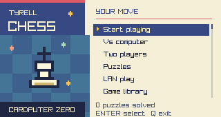
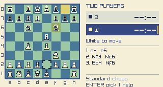

# Tyrell Chess for Cardputer Zero

A native Linux port of [Cardputer ADV Chess](https://github.com/kaini-industries/cardputer-chess), with a colorful pixel-art interface designed for the Zero's 320 × 170 LCD and keyboard. The portable engine is retained at upstream commit `64419e29c828b77b420221472e8a314778713a07`; licenses, original-file hashes and adaptations are in [engine/](engine/).

Current source is **0.1.4**, with optional offline shell lifecycle handling,
cooperative AI cancellation, shared contextual commands/help and deterministic
UI checks, including the earlier draw/move confirmation fixes at clock expiry. The retained [0.1.1 ARM64 package](../../dist/tyrell-chess/0.1.1/README.md)
remains the latest device-validated build. Current source still needs its own ARM64 package
and device qualification; see the [clock-boundary review](../../docs/chess-clock-validation.md).




## Play

Native builds may opt into experimental shell integration with
`-DTYRELL_ENABLE_SHELL_LINK=ON`; it is off in the normal M5 build. The supported
session is offline only: local games, computer opponents, puzzles and archives.
LAN hosting/joining is unavailable while linked. Desktop and headless launches
do not adopt the native shell descriptor.

Shell pause releases/reset input and stops drawing before acknowledgment,
invalidates AI results and requests cooperative search cancellation. It does
not call the chess clock's in-game pause: running match time continues while
hidden, and resume resolves flag fall before accepting input. Explicit existing
clock pauses are retained. Native resume baselines held keys and redraws fully.
Saved prelaunch pixels are never restored by linked cleanup, including quit,
signals, construction failures and exceptions; normal M5 restoration remains.

Pause acknowledgments perform no disk writes. Save failure after resume remains
visible and retries without changing ownership or clock policy. Link loss or
linked signal termination skips exit persistence, preserving the last successful
atomic save. RAM-only moves and newer clock/progress state can be lost; recovery
from that file is not uninterrupted match continuation. Cooperative AI joins
have bounded search work, not a hard OS scheduling deadline; filesystem and
device operations likewise have no universal wall-clock guarantee. Physical
M5/Gh0st acceptance remains pending for the new binaries.

Launch **Tyrell Chess** in the stock APPLaunch carousel. Choose **Vs computer**, **Two players**, or a puzzle category. Setup offers Standard/Chess960, five time controls, three computer levels, and either player color. The selected row changes with Left/Right or Enter; select **Start game** to play.

- Custom outlined pixel pieces, 18px squares, blue/mint board and coral/gold highlights.
- Legal-move dots and capture borders, check and last-move markers, optional piece motion and high-contrast colors.
- Computer search runs on one background worker; controls and clocks remain active during search, Help and game menus.
- All chess moves, promotion choices, repetition and material/clock draw handling. Chess960 distinguishes a normal king move from castling when they share a destination.
- Puzzles by category, automatic opponent replies, hints and saved progress.
- Untimed offline undo and hints; full move replay; PGN export and an offline completed-game library.
- Checked, atomic save replacement after moves and at most five seconds between clock snapshots. Damaged saves are retained as `damaged-*.save`. Failed saves/archives remain visible and block ordinary exit until retried successfully.
- Ordered key events preserve rapid taps across slow LCD frames instead of collapsing or reordering confirmations.

| Action | Keys |
| --- | --- |
| Navigate menus/board | Arrow keys, `W A S D`, or `; , . /` |
| Select piece / confirm move | Enter |
| Cycle legal destinations | Space (cycles); directions choose spatially |
| Cancel selected move / open game menu | Escape or Backspace |
| Undo (untimed offline) | U |
| Hint (untimed offline/puzzles) | H |
| Controls | I |
| Flip / high contrast | F / T |
| Move replay | V; Left/Right step, Escape returns |
| Next puzzle in current category | X |
| Export current game as PGN | P |
| Save and return to launcher | Q (confirms before leaving live LAN) |

Selecting a piece leaves the cursor on its source square. A direction selects a target in that displayed direction; Space cycles all unique targets. Enter confirms. Hold a direction to repeat after a short delay; confirmations never repeat. WASD, punctuation arrows and keypad Enter follow the same controls. Promotion has four explicit choices. Ambiguous Chess960 king/castle destinations show **Move king / Castle**. Resignation, draw agreement and replacing a live offline game require confirmation.

Game menus and Help keep clocks running. Completed or paused clocks no longer show an active indicator; action hints change for selection, game over and confirmations. Returning to the main menu pauses an offline game. Online clocks remain host-authoritative; online review is available after the game. A resumed computer game restores the human player's orientation.

## LAN play

Both Zeros need this port and the same reachable private IPv4 network. Choose **LAN play → Host a game**, select options, then **Start game**. On the other Zero choose **Join by IP**, type the host's displayed IP and press Enter. Compare the six-digit code on both screens and confirm on both. Host plays White; joiner plays Black. Pairing times out after 90 seconds. TCP port `28773` must be reachable.

The host validates turn, move sequence and legality, and synchronizes clocks/results. Joining blocks further move input until the host acknowledges the pending move. Draw offers are in the game menu; the recipient presses Y to inspect the offer, then confirms Accept draw. D remains a movement key. Late acceptances and moves arriving at flag fall preserve the agreed game result.

This uses trusted-LAN TCP, without encryption or cryptographic peer authentication. The displayed code confirms the selected pairing; it is not a security boundary. It does not interoperate with the Advance's ESP-NOW protocol. There is no Internet matchmaking or automatic host discovery.

The Zero UI uses one local resumable game and a completed-game collection. Advance NVS saves and its multi-profile statistics are not imported. Identical completed move sequences/options/results are deduplicated. Online matches export PGN but are not resumable across disconnects or power cycles.

## Saved files

Data lives in `$XDG_STATE_HOME/tyrell-chess`, or `~/.local/state/tyrell-chess` when XDG_STATE_HOME is unset. The app runs as the normal launcher user. `active.save` contains checked move replay and clock state; `puzzles` and `settings` retain progress/preferences; `games/` contains completed offline saves and PGNs; `exports/last-game.pgn` is the manual export.

Internal save/network moves use coordinate notation with a promotion letter, or an explicit `c` suffix for castling (for example `f1g1c`). This avoids ambiguous Chess960 king moves. PGN uses standard SAN and setup FEN tags for nonstandard positions.

## Build and package

From the repository root:

```sh
python3 scripts/chess deps
python3 scripts/chess build --backend headless
python3 scripts/chess test --backend headless
python3 scripts/chess package
```

Local headless tests require loopback TCP access. The package command uses the existing isolated Debian ARM64 Lima builder, runs tests plus package/install/remove checks, and exports the `.deb`, checksums and exact source manifest to `artifacts/chess-native/`. It preserves the builder's prior stopped/running state and never connects to the handheld. Desktop builds are available with `--backend desktop`; native LCD builds require Linux.

Install the exported package using the device's normal SSH user:

```sh
scp artifacts/chess-native/tyrell-chess_0.1.4-1_arm64.deb user@cardputer:/tmp/
ssh -t user@cardputer 'sudo dpkg --install /tmp/tyrell-chess_0.1.4-1_arm64.deb'
```

The package adds only the app, launcher entries, icon and notices. It installs no services or firmware. Start native graphics from APPLaunch so it can manage display/input ownership. `tyrell-chess --help` and `--version` work over SSH without opening display devices.

Automation always requires a nonempty explicit `--state-dir`, protecting actual player saves:

```sh
build/chess-headless/tyrell-chess --headless --demo --frames 3 \
  --state-dir /tmp/chess-preview --screenshot /tmp/chess-board.png
```

Optional independent chess-oracle tests are documented in [tests/oracle/](tests/oracle/README.md). The [validation report](../../docs/chess-validation.md) separates automated tests, device observations and untested physical controls.

Version 0.1.1 adds spatial keyboard navigation, controlled held-key repeat, safe draw/leave confirmations, checked puzzle/settings saving, contextual Help and clearer focus/clock states. See [the UI/input validation](../../docs/chess-ui-input-validation.md).

## Shared commands and deterministic UI validation

The current screen's action descriptors define aliases, availability, held-key
repeat, confirmation policy, contextual Help and footer hints. The common model
is the C++17 `Tyrell::AppCommands` target; rendering stays in raylib and the
existing game runtime. Help shows the controls of the screen it was opened from.
Use Left/Right for additional help pages; Enter, Escape and I still return.
Unavailable actions are omitted from Help while their established feedback (for
example a timed-game hint request) remains available.

Headless rendering accepts `--ui-time SECONDS` for deterministic animations and
notice visibility. It affects only the rendered UI snapshot, not game clocks,
AI, pairing deadlines or network liveness, and requires headless mode with an
explicit state directory. New CTest groups `chess-command-context` and
`chess-ui-layout` check controller input/help agreement and actual text draw
bounds. The layout test retains representative PNGs and a bounds report under
its build directory's `u1-previews/`; these are software-rendered evidence, not
physical LCD or M5/Zero/Gh0st acceptance.
